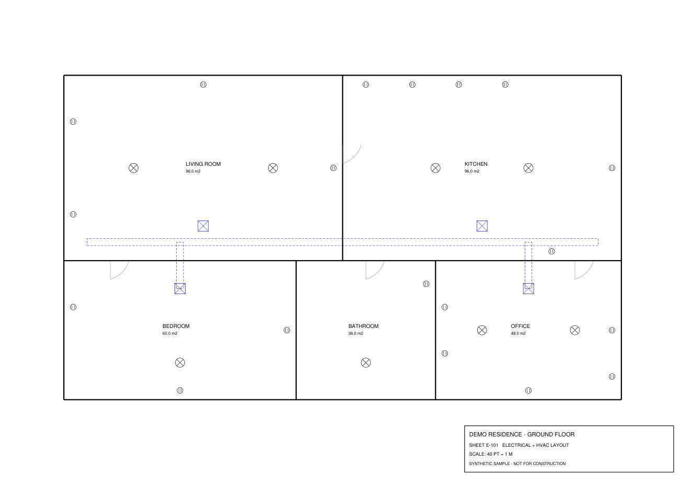
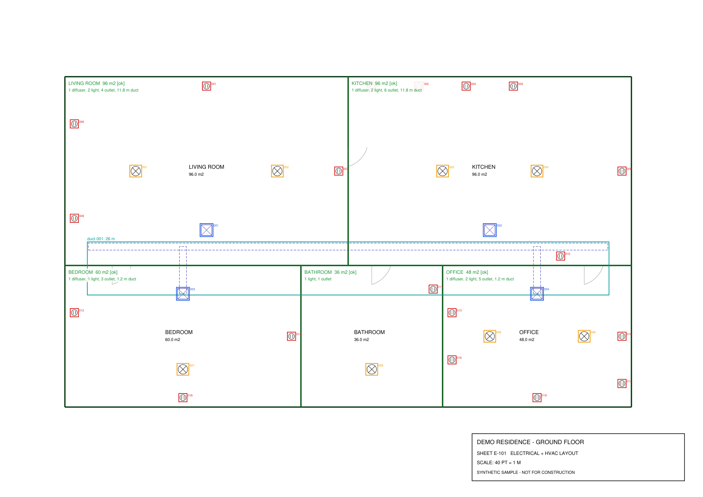

# vector-pdf-extractor

**Turn CAD-exported vector PDFs into validated, structured JSON: rooms, symbol counts per room, duct lengths and a bill of quantities.**

A CAD export throws away all meaning. What's left in the PDF is loose lines, Bézier curves and positioned text on named layers: no "outlet" or "duct" objects survive. This project rebuilds that meaning from geometry:

| Input (vector PDF) | Output (annotated QA render + JSON) |
|---|---|
|  |  |

```text
sheet 1: outlet=19, light=8, diffuser=4, duct=1, duct_length_m=26, floor_area_m2=336
```

## How it works

1. **Read** every vector path and text span with PyMuPDF, including its CAD layer (PDF optional content group) and linetype (dashed / solid).
2. **Rebuild symbols:** paths on the same layer and linetype that touch within a tolerance are merged with Shapely (buffer → union → spatial index), so the 3 primitives of a socket become one group again.
3. **Classify** each group with declarative rules in [`rules/floorplan.json`](rules/floorplan.json): layer, linetype, number of lines/curves/rectangles, size, aspect ratio. New symbol types need a rule, not new code.
4. **Rebuild rooms:** single-line walls are noded and polygonized into room polygons; the room name and printed area are read from the text *inside* each polygon.
5. **Assign and measure:** symbols go to the room containing their centre; ducts are measured along their centre lines and split per room.
6. **Validate:** output is a Pydantic model ([JSON Schema](docs/schema.json)). The computed area of every room is checked against the area printed on the drawing; mismatches, unclassified geometry and symbols outside rooms become warnings and a non-zero exit code.

Example output: [`docs/example_output.json`](docs/example_output.json)

```json
{
  "name": "KITCHEN",
  "area_m2": 96.0,
  "label_area_m2": 96.0,
  "area_check": "ok",
  "counts": { "outlet": 6, "light": 2, "diffuser": 1 },
  "duct_length_m": 11.8
}
```

## Usage

```bash
python -m venv .venv
.venv\Scripts\activate          # Windows  (source .venv/bin/activate on Linux/macOS)
pip install -r requirements.txt

python samples/make_sample.py   # (re)generate the sample drawing + ground truth
python -m vector_extract samples/floorplan.pdf --rules rules/floorplan.json --out output
python -m pytest                # acceptance tests against the ground truth
```

Outputs per PDF: `<name>.json`, `<name>_p<page>_annotated.png` and `schema.json`.

The drawing scale is read from the title block (`SCALE 1:100` or `SCALE: 40 PT = 1 M`), with a fallback in the rules file.

## Tests

The sample generator writes `samples/floorplan.truth.json` with the exact counts per room. The test suite treats it as acceptance criteria: every room, every symbol count, every area and the duct length must match, nothing may stay unclassified, and a deliberately wrong area label must be flagged.

## Project layout

```
vector_extract/
  reader.py     PDF -> paths (lines, curves, rects) + text spans, with layers
  grouping.py   Shapely clustering + rule-based classification
  rooms.py      wall network -> room polygons + labels
  pipeline.py   orchestration, scale detection, validation, totals
  models.py     Pydantic output contract
  annotate.py   QA render with detections drawn on the page
rules/          declarative symbol rules (JSON)
samples/        synthetic CAD-style floor plan generator + ground truth
tests/          acceptance tests
```

## Notes

- The sample sheet is synthetic (generated by `samples/make_sample.py`) so the repository contains no third-party drawings. It uses AIA-style layer names (`A-WALL`, `E-POWER`, `E-LITE`, `M-HVAC`, …) like real CAD exports.
- Real-world drawings usually need extra rules per drawing standard (block shapes, text styles, layer naming), but the pipeline stays the same.
